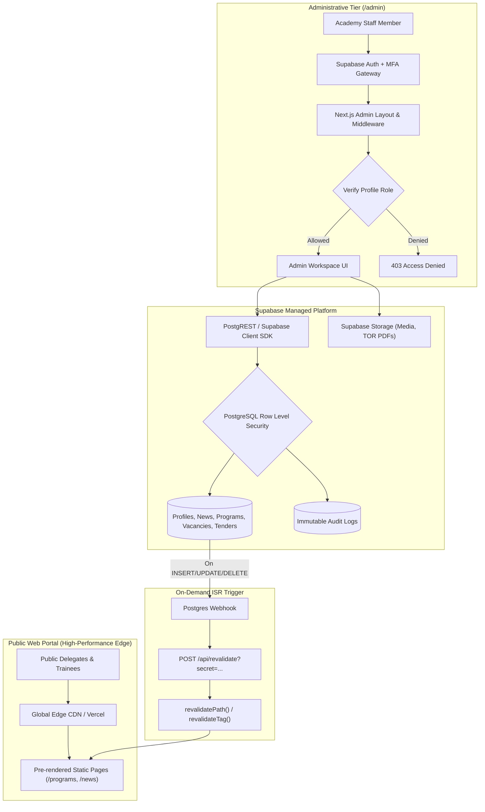
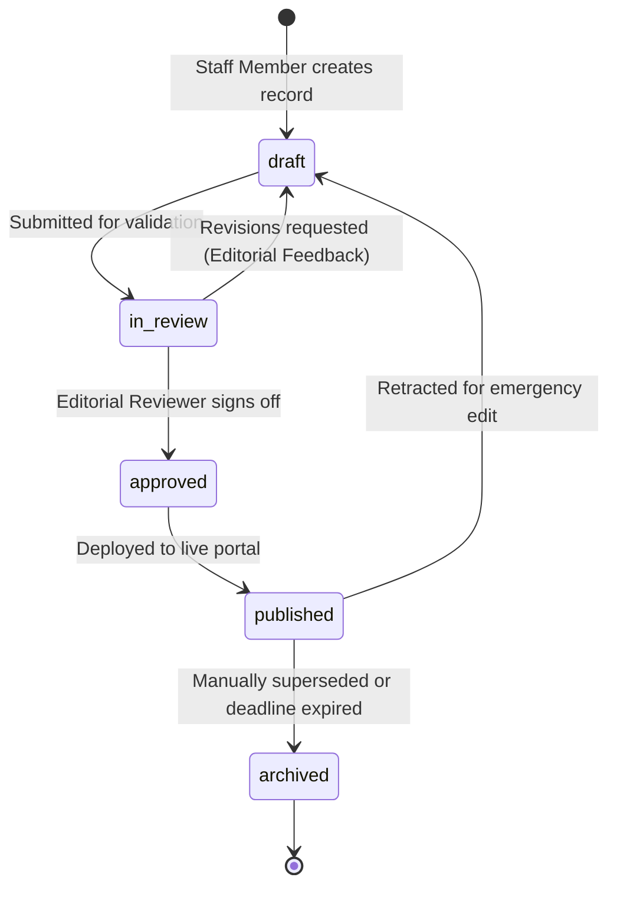

# 01 — System Architecture & Role-Based Access Control (RBAC)

**Module:** AFLEX CMS Core Governance  
**Backend:** Supabase PostgreSQL (`qezexucrwwdxgotpofph.supabase.co`)  
**Status:** Approved for Implementation  

---

## 1. High-Level Architecture

The AFLEX CMS separates the public presentation tier from the administrative management tier while maintaining a shared database layer governed by PostgreSQL Row Level Security (RLS).

---

## 2. Institutional Role Profiles

AFLEX governance requires distinct separation between content creators, legal/editorial reviewers, and executive authorities:

### 2.1. `super_admin` (Academy Chief of Staff / IT Director)
- **Authority:** Full governance oversight over all Academy digital assets.
- **Responsibilities:**
  - Provisioning and deactivating Academy staff accounts.
  - Assigning or reassigning staff roles.
  - System-wide configuration (maintenance mode, emergency banner management).
  - Emergency rollback and unpublishing authority.
  - Reviewing the complete immutable audit trail.

### 2.2. `academic_director` (Dean of Faculty & Curricula)
- **Authority:** Chief custodian of academic training programs, cohorts, and research outputs.
- **Responsibilities:**
  - Authoring and updating executive curriculum structures (Leadership Development, Project WILD, PSLE).
  - Updating cohort start dates, module lists, and transformative outcome statements.
  - Managing faculty bios and ministerial visiting appointments.
  - Direct publishing authority over academic programs and catalog courses.

### 2.3. `comms_officer` (Public Relations & Editorial Team)
- **Authority:** Creator and curator of Academy dispatches, news, and visual assets.
- **Responsibilities:**
  - Drafting and formatting news dispatches, press releases, and event summaries.
  - Providing parallel translations in **Amharic (`am`)**, **Afaan Oromoo (`om`)**, and **English (`en`)**.
  - Uploading event photography, videos, and album metadata to the Media Archive.
  - Submitting drafts for editorial review (cannot publish directly without sign-off).

### 2.4. `hr_procurement_officer` (Human Resources & Finance Directors)
- **Authority:** Custodian of institutional hiring and public procurement tenders.
- **Responsibilities:**
  - Drafting and publishing career postings and senior research fellowships.
  - Tracking vacancy status, deadlines, and closing expired job openings.
  - Publishing public tender notices (`/procurement`), uploading bid documentation (PDFs), and entering bid bond amounts.
  - Reviewing candidate dossier counts.

### 2.5. `editorial_reviewer` (Senior Academy Editor / Legal Advisor)
- **Authority:** Quality assurance gatekeeper ensuring factual accuracy, political sensitivity, translation quality, and legal compliance.
- **Responsibilities:**
  - Reviewing all staged content submitted by `comms_officer` and `hr_procurement_officer`.
  - Adding line-item review comments or requesting revisions.
  - Authorizing the final transition from `in_review` to `published`.

### 2.6. `auditor` (Federal Ethics & Compliance Officer)
- **Authority:** Independent oversight officer.
- **Responsibilities:**
  - Read-only visibility into all draft, published, and archived records.
  - Unrestricted read access to `public.audit_logs`.
  - Generating compliance and audit exports for federal oversight bodies.

---

## 3. Comprehensive Permissions Matrix

| Entity & Action | `super_admin` | `academic_director` | `comms_officer` | `hr_procurement_officer` | `editorial_reviewer` | `auditor` | Public (Anon) |
| :--- | :---: | :---: | :---: | :---: | :---: | :---: | :---: |
| **News: View Drafts** | ✅ | ✅ | ✅ (Own + Staged) | ❌ | ✅ | ✅ | ❌ |
| **News: Create / Edit** | ✅ | ❌ | ✅ | ❌ | ✅ | ❌ | ❌ |
| **News: Publish** | ✅ | ❌ | ❌ | ❌ | ✅ | ❌ | ❌ |
| **News: Read Published** | ✅ | ✅ | ✅ | ✅ | ✅ | ✅ | ✅ |
| **Programs: Edit Curriculum** | ✅ | ✅ | ❌ | ❌ | ❌ | ❌ | ❌ |
| **Programs: Publish Offerings**| ✅ | ✅ | ❌ | ❌ | ❌ | ❌ | ❌ |
| **Vacancies: Create / Edit** | ✅ | ❌ | ❌ | ✅ | ✅ | ❌ | ❌ |
| **Vacancies: Publish Openings**| ✅ | ❌ | ❌ | ✅ | ✅ | ❌ | ❌ |
| **Procurement: Post Tenders** | ✅ | ❌ | ❌ | ✅ | ❌ | ❌ | ❌ |
| **Procurement: View Bids** | ✅ | ❌ | ❌ | ✅ | ❌ | ✅ | ❌ |
| **Media: Upload Assets** | ✅ | ✅ | ✅ | ✅ | ✅ | ❌ | ❌ |
| **Media: Delete Assets** | ✅ | ❌ | ❌ | ❌ | ❌ | ❌ | ❌ |
| **User: Provision Staff** | ✅ | ❌ | ❌ | ❌ | ❌ | ❌ | ❌ |
| **Audit Logs: Read All** | ✅ | ❌ | ❌ | ❌ | ❌ | ✅ | ❌ |

---

## 4. Content Approval Lifecycle State Machine

Every public publication adheres to an immutable five-state lifecycle:

### Lifecycle Rules:
1. **Draft State (`draft`):** Visible exclusively to the author and `super_admin`. Can be updated freely without triggering audit log noise.
2. **Review State (`in_review`):** Locked against edits by the author. Notifies `editorial_reviewer` via email/dashboard alert. Requires verification of:
   - English, Amharic, and Afaan Oromoo translations.
   - Alignment with official FDRE ministerial naming conventions.
   - High-resolution, copyright-compliant photography.
3. **Approved State (`approved`):** Content is locked and queued for immediate or scheduled release.
4. **Published State (`published`):** Record becomes visible to public queries through Supabase RLS. Triggers the On-Demand ISR webhook (`/api/revalidate`).
5. **Archived State (`archived`):** Soft-deleted from public lists (e.g., closed vacancies or completed tenders) while remaining historically intact for federal compliance audits.

---

## 5. Emergency Procedures & Unpublishing Protocols

- **Emergency Unpublish:** In the event of a factual error, legal notice, or security retraction, a `super_admin` can click **Emergency Retract** on any published entity.
- **Technical Action:** Sets `status = 'draft'` and immediately calls `/api/revalidate?tag={entity}` with priority execution. The public edge cache clears within $\le 300\text{ms}$.
- **Mandatory Audit Note:** Retraction requires entering an official justification text stored permanently in `audit_logs.changes`.

